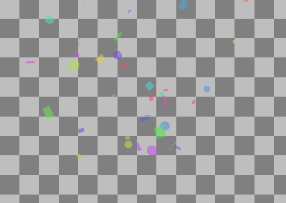
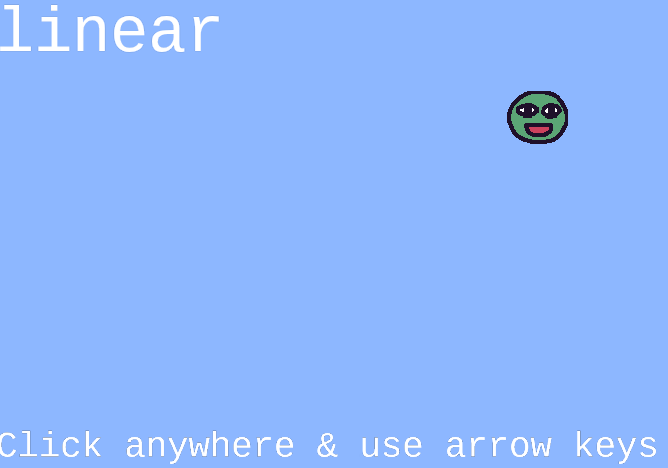
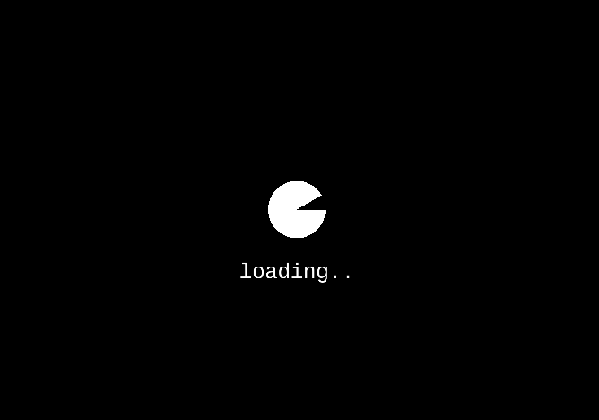

# Entry 1
##### 11/13/26

### Context:

When we first started SEP11 & talking about our tools and what we wanted to focus on, I was fully lost. This was because I had no idea what to tool to use or what game I wanted to create. This caused me to think about all the quick/easy js games that I had played in the past. This reminded me of games like :[ Cookie Clicker ](https://orteil.dashnet.org/cookieclicker/), [ Papa's Pizzeria ](https://www.coolmathgames.com/0-papas-pizzeria?variant=next), + other simulator games that use Js. This got me thinking... why dont I just make a simple simulator game using the Js code we have learned so far??? However, I later relaized that this wasnt going to be so easy since I still have to figure out what Tool to use to be able to do so- which is where I landed on the tool : <u>KABOOM.</u>

#### TOOL? + WHY?:

I decided on KABOOM since when I was researching from the SEP11 projects tool list, I realized that even though Kaboom was the most popular, it was most likely the best option when it came to programming/ making a game. This means that I picked my tool in the begining for convienince ; on what was the best/ easiest option for creating a simulator game using basic Java-script. Furthermore explaining what I want to create using KABOOM, is that I want to make a game where a user can pick a flavour, add toppings (like sprinkles, cherries,etc.), and top everything off with some amazing whipped cream. 

### EDP :

The process + the tinkering that I've done has taken me the most time so far. This means that I tinkered with [KABOOM.js](https://kaboomjs.com/) repeatedly, allowing me to discover different types of codes to incorporate into my game. 

#### #1  Confetti:
When I was looking around on the different types of code used in the Kaboom-playground, I came across "CONFETTI". This particular code really intrigued me, and I really wanted to add it into my game:




This image is basically the output that the code gives after a user clicks on the screen


The way I want to add this specific code is after a user finishes making their order.

#### #2 Tween :

I also want to use tween since its what will help the user put on some of their toppings.



This image basically shows the icon/image following the direction of my arrow (arrow doesnt show since it disapeared). This demonstrates how the topping icons will follow the users mouse/arrow to place on top of their ice cream.

#### #3 Loader :

Lastly, I've also wanted to incorporate a loading screen into my code in some way, so "LOADER" was one of my options when I was tinkering with the different ways the KABOOM can be used. 


This peice if pretty much self-explanatory since its going to pop up in the beggining of the code.

ALSO, one thing I realized was that each peice of KABOOM code had to start with :


```Js
<script src="https://unpkg.com/kaboom/dist/kaboom.js"></script>
```


### Skills : 

When learning about <u>KABOOM</u>, I had to realize some things;

* Be patient/ realistic : When I was first thinking about what I wanted to make, I had soooo many ideas about what I had in mind. This basically means that my ideas were bigger than what I was able to do with my current knowledge of js; showcasing that I needed to slow down and think about what I can ACTUALLY make without quitting.

* Do your research on your own : This part was the hardest for me to understand since when it comes to school matters, I usually go with what other people pick. However, I kind of got a wakeup call when Mr.Mueller pointed out the fact that people whom pick a tool just because everyone else picked it, end up wasting their time on a tool that might not even be what they are looking for in the end.


[Next](entry02.md)

[Home](../README.md)